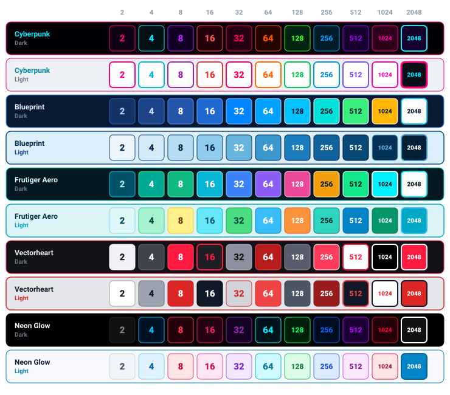
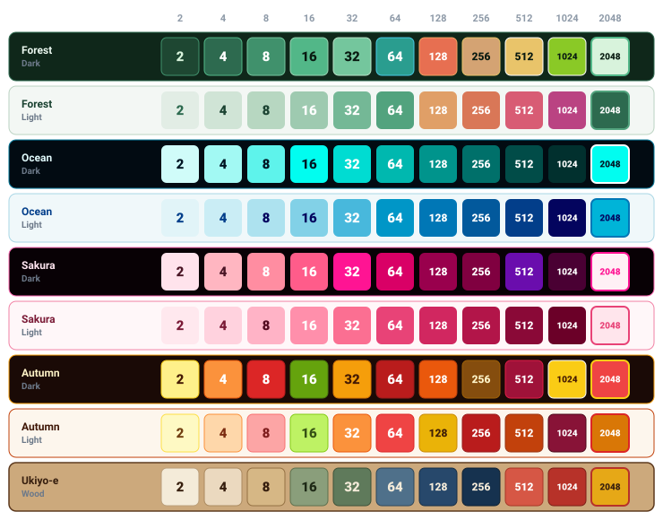
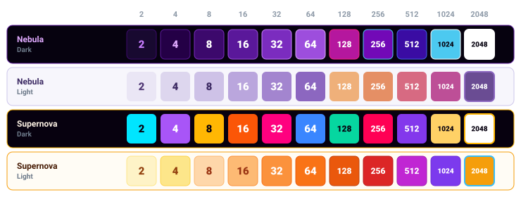
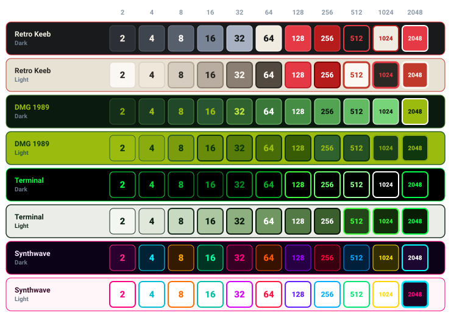
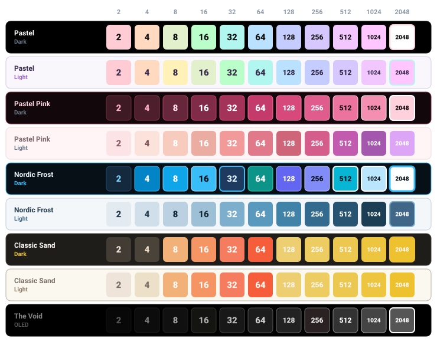

# 2048 Reimagined

A modular, high-performance Progressive Web App (PWA) implementation of the classic 2048 puzzle game, featuring a dynamic multi-theme visual engine, embedded chiptune soundtrack, reactive frequency visualizer, and hardware-accelerated canvas physics.

Designed for responsive execution across desktop and mobile browsers, supporting both portrait and landscape viewports with offline service worker caching and standalone native installation.

Play at [2048reimagined.pages.dev](https://2048reimagined.pages.dev/) or [farhan-real.github.io/2048Reimagined-Web](https://farhan-real.github.io/2048Reimagined-Web/)

---

## Core Features

- Progressive Web App (PWA): Fully installable on Desktop (Chrome, Edge, Safari, Brave) and Mobile (Android, iOS) with offline execution and standalone window mode.
- Offline Service Worker: Robust precaching of core scripts, styles, layouts, and procedural sound pipelines for instant loading without a network connection.
- Modular Visual Engine: Over 20 distinct visual palettes organized into thematic categories, supporting live toggling between Dark, Light, and specialized canvas surface treatments.
- Integrated Audio Architecture: Built-in audio controller with playlist curation, progress tracking, WebAudio procedural sound synthesis, and a 25-track chiptune library.
- Continuous Spectral Visualizer: Real-time frequency response system with harmonic smoothing to eliminate abrupt frequency-band stepping, supporting Full Bottom, Isolated Box, and Landscape panel rendering modes.
- Hardware-Accelerated Effects: Low-overhead HTML5 Canvas particle emission engine utilizing sub-pixel bounding box placement for tile merge bursts.
- Input Adaptability: Unified pointer gesture handling supporting mobile touch swipes, desktop mouse drags, and discrete keyboard inputs.
- Deterministic Gameplay Mode: Optional seeded pseudo-random number generator (Mulberry32) ensuring move reproducibility and preventing undo-based RNG exploitation.
- State Persistence and Analytics: LocalStorage caching for session board states, undo history, personal records, and a top-five leaderboard with duration metrics.

---

## Installation (PWA)

### Desktop (Chrome, Edge, Brave, Opera)
1. Open the game in any Chromium-based browser.
2. Click the **Install App** icon button in the top navigation bar or the browser's address bar install icon.
3. Confirm installation to launch 2048 Reimagined in its own dedicated, chromeless application window.

### Mobile (Android & iOS)
- Android (Chrome): Tap the top navigation install icon or select **Install app** / **Add to Home screen** from the browser menu.
- iOS (Safari): Tap the **Share** button and select **Add to Home Screen**.

---

## Theme Showcase

The game separates visual appearance into standalone CSS modular palettes. Color schemes maintain high contrast and distinct color tiers for every numerical threshold.

### Cyber & Technical
Themes: Cyberpunk, Blueprint, Frutiger Aero, Vectorheart, Neon Glow.



### Nature & Classical Art
Themes: Forest, Ocean, Sakura Bloom, Autumn Maple, Ukiyo-e Woodblock.



### Space & Astronomy
Themes: Stellar Nebula, Supernova Solar Flare.



### Retro Computing & Hardware
Themes: Retro Keeb, DMG 1989 (Game Boy pea-soup LCD), Terminal CRT, Synthwave Outrun.



### Minimal & High-Contrast
Themes: Pastel Rainbow, Pastel Pink, Nordic Frost, Classic Sand, The Void (True OLED).



---

## Controls

### Keyboard (Desktop)
| Key Binding | Action |
| :--- | :--- |
| Arrow Up / W | Slide tiles upward |
| Arrow Down / S | Slide tiles downward |
| Arrow Left / A | Slide tiles left |
| Arrow Right / D | Slide tiles right |
| Z / U | Undo previous move |
| R | Restart game session |
| Space | Toggle audio playback |
| Escape | Close active dialog or prompt exit |

### Touch and Mouse
- Swipe or drag across the board container in any cardinal direction to trigger a move.
- Interactive modal sheets, volume sliders, and playlist selectors handle standard touch and pointer interactions independently of the board gesture detector.

---

## Project Structure

```
.
|-- css/
|   |-- base/           # Layout grid, responsive orientation, and CSS variables
|   |-- components/     # Board container, navigation, and music widget styles
|   |-- modals/         # Dialog sheets, settings panel, and leaderboard views
|   `-- themes/         # Categorized stylesheets (cyber, minimal, nature, retro, space)
|-- icons/              # Vector PWA launcher and adaptive maskable icons
|-- js/
|   |-- audio/          # Playback engine, procedural SFX, and visualizer pipelines
|   |-- core/           # Board grid, tile instances, PRNG, and storage controllers
|   |-- features/       # Particle physics, timer tracking, and leaderboard logic
|   `-- ui/             # View controllers, theme selectors, and settings bindings
|-- music/              # Curated 192kbps chiptune soundtrack files
|-- previews/           # Scalable theme reference SVGs
|-- ai.md               # Repository standards and development instructions
|-- index.html          # Application entry point and layout structure
|-- manifest.json       # Web app install manifest and metadata
`-- sw.js               # Service Worker for offline caching
```

---

## Local Setup

The project relies entirely on native browser standards (ES6 modules, Canvas API, Web Audio API, Service Worker Cache API, and CSS Custom Properties) and requires no build steps, bundlers, or package installations.

1. Clone the repository:
   ```bash
   git clone https://github.com/farhan-real/2048-Reimagined.git
   cd 2048-Reimagined
   ```

2. Serve the directory using any static HTTP server:
   ```bash
   # Python 3
   python3 -m http.server 8000

   # Node.js
   npx serve .
   ```

3. Open `http://localhost:8000` in your web browser.

---

## Technical Specifications

- Target Standards: ECMAScript 2020+, HTML5 Canvas, Web Audio API, Service Worker Cache API.
- Rendering Target: 60Hz - 144Hz high refresh rate viewports.
- Responsive Range: Optimized for mobile viewports (down to 320px width) up to 4K desktop landscape displays.
- Storage Footprint: Pure client-side execution; all state stored locally via the Web Storage API.

---

## Credits

- Game Design: Original 2048 puzzle mechanics by Gabriele Cirulli.
- Architecture and Implementation: Farhan.
- Soundtrack Composers: Dubmood, Zabutom, Zalza, Floppi, Jakim, ko0x, Moodmode, Oxbow, rez, kenet, 0BiT, GEAR, SnD.
---

---

## License

This project is licensed under the [GNU Affero General Public License v3.0 (AGPL-3.0)](LICENSE).

**Music & Soundtrack Disclaimer:** All chiptune music tracks included in this repository belong to their respective original artists and composers. The audio files are not licensed under the AGPL-3.0 license, and all intellectual property and copyright rights remain reserved to their respective creators.